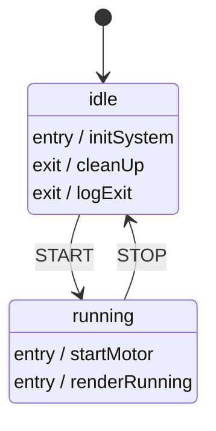

Implement feature: `entry` and `exit` action arrays

### Machine Definition
```json
{
  "id": "action_test",
  "initial": "idle",
  "states": {
    "idle": {
      "entry": ["initSystem"],
      "exit": ["cleanUp", "logExit"],
      "on": {
        "START": { "target": "running" }
      }
    },
    "running": {
      "entry": ["startMotor", "renderRunning"],
      "on": {
        "STOP": { "target": "idle" }
      }
    }
  }
}
```

### Mermaid Topology


## Semantic Verification Proof

**States & Topology**
- [x] Initial state is correctly mapped to `idle`
- [x] State `idle` exists (aliased as `action_test_idle`)
- [x] State `running` exists (aliased as `action_test_running`)

**Transitions**
- [x] Event `START` correctly transitions `idle` -> `running`
- [x] Event `STOP` correctly transitions `running` -> `idle`

**Actions & Guards**
- [x] Entry action `initSystem` on state `idle` correctly mapped as `entry / initSystem`
- [x] Exit action `cleanUp` on state `idle` correctly mapped as `exit / cleanUp`
- [x] Exit action `logExit` on state `idle` correctly mapped as `exit / logExit`
- [x] Entry action `startMotor` on state `running` correctly mapped as `entry / startMotor`
- [x] Entry action `renderRunning` on state `running` correctly mapped as `entry / renderRunning`
- [x] No guards present in JSON; none rendered in Mermaid

**Validation Result**: PASS
