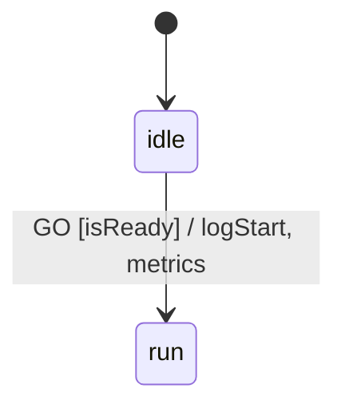

# xstate-diagram

Convert [XState v5](https://stately.ai/docs/xstate) JSON machine definitions into [Mermaid](https://mermaid.js.org/syntax/stateDiagram.html) `stateDiagram-v2` diagrams.

`xstate-diagram` ingests XState v5 JSON configurations (via `--file` or `stdin`), resolves the state machine graph using XState's `createMachine`, and outputs deterministic Mermaid state diagram syntax to `stdout`.

## Features

- **Flat & Hierarchical States**: Compiles nested/composite state hierarchies with scoped initial states (`[*] --> ...`).
- **Parallel Regions**: Renders orthogonal state regions (`type: "parallel"`) with Mermaid `--` concurrency dividers.
- **Rich Transition Labels**: Formats transitions as `EVENT [guard] / action1, action2`.
- **Eventless (`always`) & Delayed (`after`) Transitions**: Supports transient `always` transitions and `after` timeout transitions (`after <ms>`).
- **Entry & Exit Actions**: Renders `entry / <action>` and `exit / <action>` annotations on both atomic and composite states.
- **Final States & Custom IDs**: Maps `type: "final"` nodes (`--> [*]`) and resolves cross-hierarchy `#id` targets with sanitized Mermaid aliases.
- **Unix Pipeline Friendly**: Reads from `--file` or `stdin` and writes directly to `stdout` for easy composition with `@mermaid-js/mermaid-cli` (`mmdc`).

## Requirements

- **Node.js**: `>=20`

## Installation & Setup

```bash
git clone https://github.com/emmby/xstate-diagram.git
cd xstate-diagram
npm install
npm run build
```

## Usage

### CLI

Pass an XState JSON file using `-f` / `--file`:

```bash
npx xstate-diagram --file specs/supported/advanced_transitions.json
# or during development:
npm start -- --file specs/supported/advanced_transitions.json
```

Or pipe JSON directly via `stdin`:

```bash
cat specs/supported/basic_flat_machine.json | npx xstate-diagram
```

#### Exporting to SVG / PNG with Mermaid CLI

Because `xstate-diagram` writes pure Mermaid syntax to `stdout`, you can pipe its output directly to `@mermaid-js/mermaid-cli` (`mmdc`):

```bash
npx xstate-diagram -f specs/supported/parallel_002.json | npx mmdc -i - -o diagram.svg
```

### Programmatic API

You can also use the [`compile`](src/compiler.ts) function directly in TypeScript/JavaScript with an XState v5 machine instance:

```ts
import { createMachine } from 'xstate';
import { compile } from './src/compiler';

const machine = createMachine({
  id: 'advanced',
  initial: 'idle',
  states: {
    idle: {
      on: {
        GO: {
          target: 'run',
          guard: 'isReady',
          actions: ['logStart', { type: 'metrics' }]
        }
      }
    },
    run: {}
  }
});

console.log(compile(machine));
```

## Example

**Input (`advanced_transitions.json`):**

```json
{
  "id": "advanced",
  "initial": "idle",
  "states": {
    "idle": {
      "on": {
        "GO": {
          "target": "run",
          "guard": "isReady",
          "actions": ["logStart", { "type": "metrics" }]
        }
      }
    },
    "run": {}
  }
}
```

**Output (`stateDiagram-v2`):**



## Testing & Validation

The test suite validates every supported XState specification in `specs/supported/` against golden snapshots in `src/__snapshots__/` and runs syntax verification through `mmdc` (`@mermaid-js/mermaid-cli`).

```bash
# Run the full Jest test suite
npm test

# Update golden .mermaid snapshots when adding new specs
UPDATE_SNAPSHOTS=1 npm test
```

### Semantic PR Validation

When promoting a new spec from `specs/unsupported/` to `specs/supported/`, validate both `mmdc` rendering and semantic parity (via the `gemini` CLI and `prompts/semantic_validation.md`):

```bash
./scripts/validate_pr.sh specs/supported/<spec_name>.json src/__snapshots__/<spec_name>.mermaid
```

## Project Structure

```text
├── src/
│   ├── cli.ts            # CLI entrypoint (--file and stdin handling)
│   ├── compiler.ts       # XState v5 StateMachine -> Mermaid stateDiagram-v2 compiler
│   ├── cli.test.ts       # Jest test suite & dynamic spec runner
│   ├── test-helper.ts    # Golden snapshot matcher + mmdc syntax verifier
│   └── __snapshots__/    # Golden .mermaid outputs for all supported specs
├── specs/
│   ├── 001_overview.md   # Architecture & phased requirements spec
│   ├── 002_recipe.md     # Agent workflow for scaling XState feature coverage
│   ├── supported/        # Passing XState v5 JSON machine definitions
│   └── unsupported/      # Backlog of extracted XState v5 test cases
├── prompts/
│   └── semantic_validation.md # Prompt template for LLM semantic parity verification
└── scripts/
    ├── extract.ts        # AST extractor for pulling XState v5 test cases into JSON
    └── validate_pr.sh    # Automated mmdc + Gemini semantic validation script
```

## License

ISC
