# Agile Feature Agent Recipe
Because this is simply a horizontal scaling operation covering a matrix of individual language features (Hierarchical States, Parallel Regions, History Nodes, Delays, etc.), we enforce this strictly uniform implementation workflow on all agents iterating over the test suite.

## The Agent Loop

### Step 1: Ingest the Specification Matrix
- Receive the target XState feature definition for the current iteration (e.g., hierarchical mappings).
- Create a new `{feature_name}.json` file explicitly inside the `specs/` directory to house the raw state machine mock config (example: `specs/hierarchical_states.json`).

### Step 2: Compiler Implementation
- Modify `src/compiler.ts` to natively parse the new JSON sub-properties matching the current structural iteration targets (e.g., parsing `type: 'parallel'`, looping deep nesting tree depths, or parsing delayed `after` transitions).
- Assert the newly extracted AST properties and accurately serialize them into deterministic Mermaid `stateDiagram-v2` topology string representations.

### Step 3: Register Matrix Tests & Pass Jest
- Open `src/cli.test.ts`.
- Inject a new test block into the structural `testCases` array: `{ desc: 'should implement {feature}', name: '{feature_name}' }`.
- Run the local test suite via `npm test`. 
  > [!IMPORTANT]
  > This test block intrinsically executes `@mermaid-js/parser` validating the strict character syntax of your `compiler.ts` logic output without false positives. Do not bypass this.

### Step 4: Execute Agentic Semantic Pipeline
- Run our semantic evaluation pipeline wrapper specifically against the target artifacts:
  `./scripts/validate_pr.sh specs/{feature_name}.json src/__snapshots__/{feature_name}.mermaid`
- Ensure the bash wrapper prints **Exit Code `0`** natively. This systematically proves:
    1. `mmdc` natively traced the topological relationships and dropped `specs/001_proof.svg` into the tree without `Puppeteer` sandbox crashes.
    2. The `gemini` LLM parsed your string stdout, compared it aggressively against the raw mapping tree config structurally, and asserted the layout matching perfectly.
- Explicitly copy the **Semantic Checkboxes (`[x]`) payload** printed to the stdout for the next step.

### Step 5: Assemble PR Proof Formatting
- Ensure both you and the user are on a fresh `git worktree` and formally commit the modified file structures.
- Submit or propose a GitHub Pull Request natively mapping your branch.
- Assemble the Pull Request description EXACTLY matching the format below. Drop the `gemini` standard output checklist explicitly into the text body under the `## Semantic Verification Proof` header logic.
- Execute the exact GitHub Blob URL mapping for the graphic asset. You MUST append `?raw=true` natively on the blob URL wrapper to seamlessly bypass GitHub's private security blockade preventing implicit external 404 images:

#### Standardized PR Template Structure
```markdown
Implement feature: {feature_name}

### Validation Proof


## Semantic Verification Proof

{INSERT_BASH_LLM_OUTPUT_CHECKLIST_HERE}
```

- Hand off to the human reviewer!
